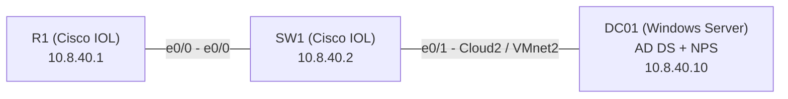
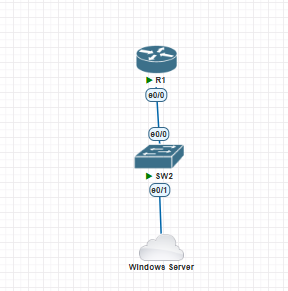
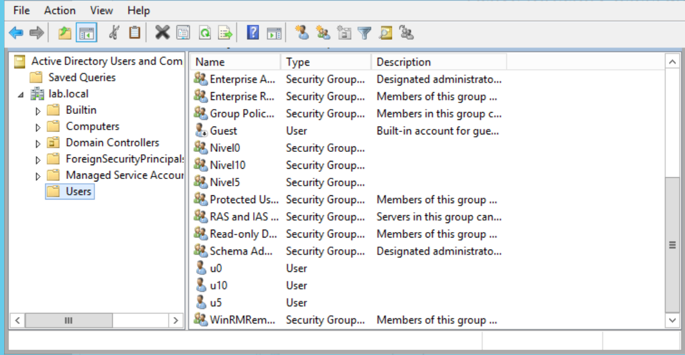
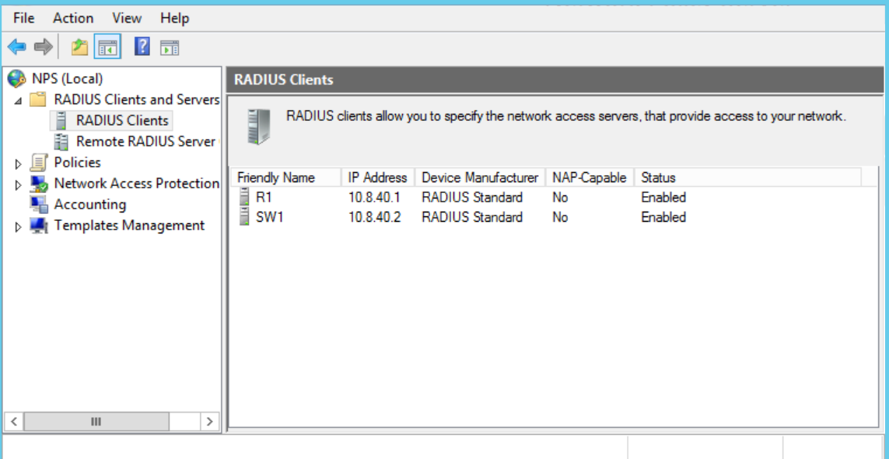
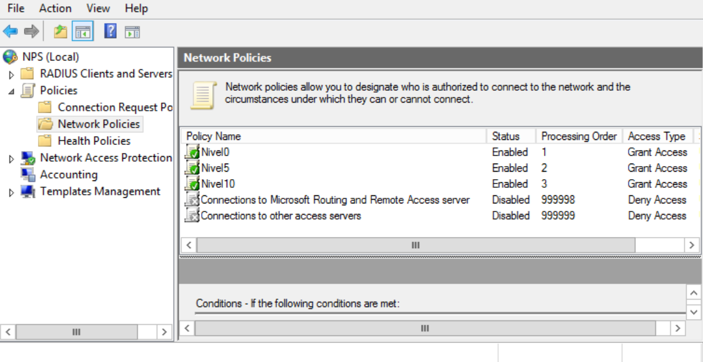
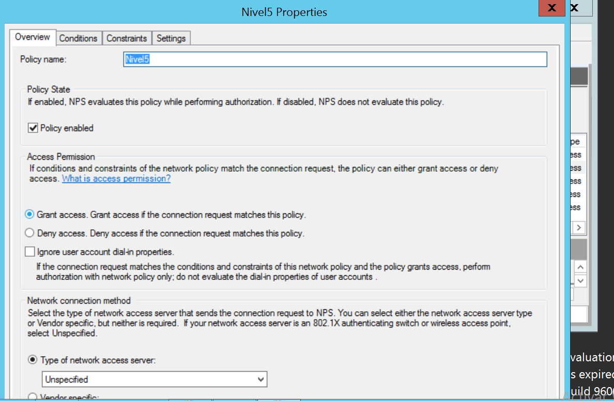
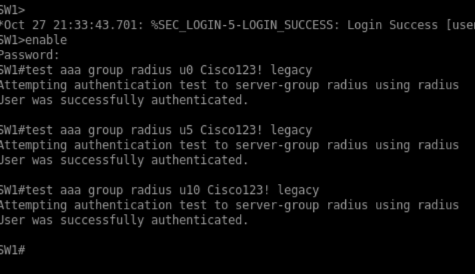
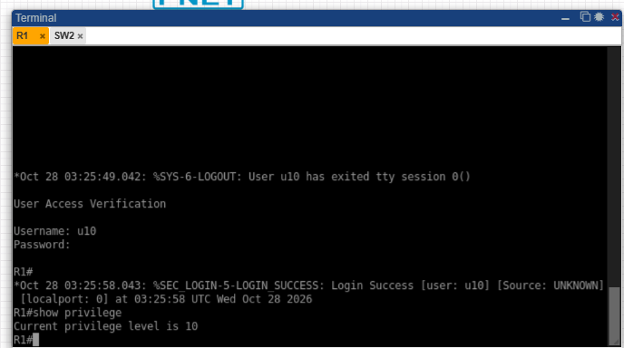

# Seguridad de Redes: AAA con RADIUS (NPS) y Active Directory

> **Aaron Hernandez · Matrícula 2025-0800 · ITLA**

##  Video demostrativo

[]([PEGA-AQUI-EL-LINK-DE-YOUTUBE](https://youtu.be/oGAVpDd3XXU))

**Enlace:** [PEGA-AQUI-EL-LINK-DE-YOUTUBE](https://youtu.be/oGAVpDd3XXU)

---

##  Propósito del laboratorio

Implementar un esquema de **autenticación, autorización y contabilidad (AAA)** en un router y un switch Cisco, usando **RADIUS** con un servidor **NPS** respaldado por **Active Directory**. El acceso administrativo por consola y auxiliar se valida contra el dominio y recibe un **nivel de privilegio (0, 5 o 10)** según el grupo del usuario. Además se habilita **SSH** con usuario local, y **logs** de autenticación, autorización y RADIUS.

##  Topología





> El router y el switch corren en **PNETLab**. El servidor **DC01** corre en **VMware Workstation** y se conecta a la topología por la red `VMnet2` (host-only), que PNETLab expone como `Cloud2`.

##  Direccionamiento

Basado en la matrícula 2025-0800.

| Equipo | Interfaz | Dirección |
|---|---|---|
| R1 | e0/0 | 10.8.40.1/24 |
| SW1 | VLAN 1 | 10.8.40.2/24 |
| DC01 | Ethernet1 | 10.8.40.10/24 |

Dominio: `lab.local`.

##  Requisitos cumplidos

| Requisito | Router | Switch | Servidor |
|---|:---:|:---:|:---:|
| Seguridad en autenticación y autorización | ✔ | ✔ | n/a |
| RADIUS como cliente | ✔ | ✔ | n/a |
| Usuario local | ✔ | ✔ | n/a |
| AAA RADIUS solo en consola y auxiliar | ✔ | ✔ | n/a |
| Logs de autenticación, autorización y RADIUS | ✔ | ✔ | n/a |
| Servicio SSH | ✔ | ✔ | n/a |
| Active Directory: grupos Nivel0, Nivel5, Nivel10 | n/a | n/a | ✔ |
| Servicio NPS | n/a | n/a | ✔ |

##  Cómo funciona

| Usuario AD | Grupo | Cisco-AV-Pair | Nivel de privilegio |
|---|---|---|---|
| `u0` | Nivel0 | `shell:priv-lvl=0` | 0 |
| `u5` | Nivel5 | `shell:priv-lvl=5` | 5 |
| `u10` | Nivel10 | `shell:priv-lvl=10` | 10 |

1. El usuario entra por la **consola** o el **auxiliar** del equipo.
2. El equipo envía la petición RADIUS (UDP 1812) al **NPS** en `10.8.40.10`.
3. NPS valida el usuario contra **Active Directory** y busca la política que coincida con su grupo.
4. NPS responde con el atributo `Cisco-AV-Pair` y el equipo asigna el nivel de privilegio.
5. Cada inicio de sesión y comando queda registrado (accounting) y en los logs del equipo.
6. Por **SSH** se usa el usuario local `admin`.

##  Configuración

Todos los scripts usados están en el repositorio:

| Archivo | Contenido |
|---|---|
| [`configs/R1-comandos.txt`](configs/R1-comandos.txt) | Comandos aplicados en R1 |
| [`configs/SW1-comandos.txt`](configs/SW1-comandos.txt) | Comandos aplicados en SW1 |
| [`configs/DC01-powershell.txt`](configs/DC01-powershell.txt) | PowerShell de red, AD y NPS en el servidor |
| [`running-configs/R1-running-config.txt`](running-configs/R1-running-config.txt) | Running-config de R1 |
| [`running-configs/SW1-running-config.txt`](running-configs/SW1-running-config.txt) | Running-config de SW1 |

### Servidor DC01 (Active Directory y NPS)

1. IP estática, dominio `lab.local` y grupos `Nivel0`, `Nivel5`, `Nivel10` con sus usuarios.
2. Rol NPS registrado en AD y clientes RADIUS `R1` y `SW1`.
3. Tres políticas de red, una por grupo: autenticación **PAP**, `Service-Type = Login` y `Cisco-AV-Pair` con el nivel correspondiente.






### Router y switch

Se configuró AAA con una lista `CON-AUTH` (RADIUS con respaldo local) aplicada solo a las líneas `con 0` y `aux 0`, autorización de `exec` por RADIUS (con `aaa authorization console`, necesario para que IOS aplique el nivel de privilegio en la consola), accounting por RADIUS, bloqueo por intentos fallidos, logs de login, y SSH versión 2 en las líneas vty con el usuario local.

##  Pruebas y evidencias

| # | Prueba | Resultado esperado |
|---|---|---|
| 1 | `test aaa group radius u0/u5/u10 ... legacy` | `User was successfully authenticated` |
| 2 | Login por consola con `u0`, `u5` y `u10` (sin usar `enable`) y `show privilege` | Niveles 0, 5 y 10 |
| 3 | SSH con `admin` a R1 y SW1 | Acceso concedido |






##  Estructura del repositorio

```
README.md
configs/
running-configs/
img/
``` 